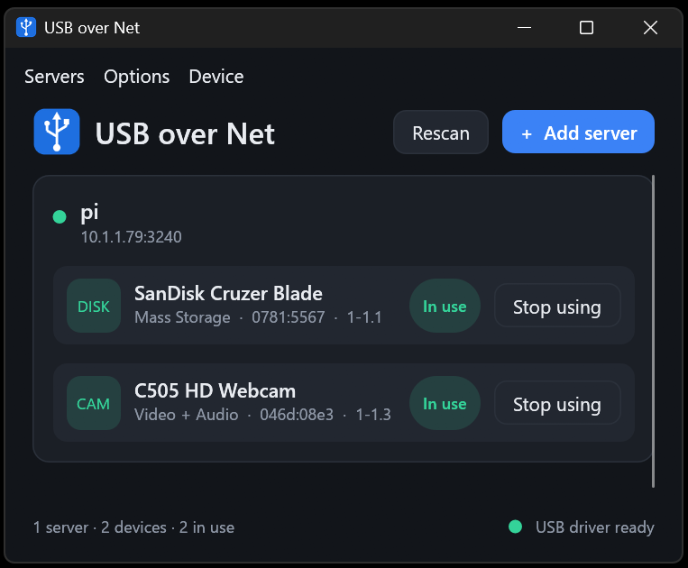

# USB over Net

Share USB devices over your network.

A small **server for Raspberry Pi** (or any Linux machine) exports the USB devices plugged into it.
A **Windows tray app** finds the server by itself, lists its devices, and attaches one with a
double-click, so Windows treats it as if it were plugged into the PC. No IP addresses to type, no
separate driver installer to hunt down.

Both programs are written in Rust and speak the standard [USB/IP](https://docs.kernel.org/usb/usbip_protocol.html) protocol.



## Features

- **Automatic discovery.** Servers on your network appear by themselves (mDNS plus a subnet scan), with their devices underneath.
- **Tray app with a modern UI.** Light, dark or system theme, a window that remembers its position and size, "Start with Windows", and "Start minimized".
- **Readable device names.** "Logitech HD Webcam C505" instead of "Miscellaneous" (needs this project's server; see [Device names](#device-names)).
- **One-click driver.** The app installs and removes the signed Windows USB/IP driver for you, driver only, with no extra apps.
- **Works with** a USB mouse and a webcam (isochronous transfers) on a Raspberry Pi. Other device types should work but are untested; see [Status](#status).
- **A proper server.** Asynchronous, cancellable libusb transfers, per-endpoint ordering, busy tracking, mDNS announcement, an allow-list, and a systemd unit.

## How it fits together

```
Windows PC                                       Raspberry Pi
  usbip-tray.exe   (this repo: GUI, discovery)     usbip-server   (this repo: libusb + USB/IP)
        | runs                                          ^
  usbip.exe + driver   (usbip-win2) ----- TCP 3240 -----+
```

Windows can only show a network device as a local one through a kernel driver, and kernel drivers
must be signed by Microsoft. This project does not ship its own. It uses the signed
[usbip-win2](https://github.com/vadimgrn/usbip-win2) driver, which the tray app installs on request.
No kernel code lives in this repository.

## Quick start

1. **On the Pi:** clone the repo and run the installer ([details](#install-the-server-raspberry-pi--linux)):
   ```sh
   sudo apt install git
   git clone https://github.com/DnG-Crafts/USB-over-Net.git
   cd USB-over-Net
   sudo chmod 777 install.sh
   sudo chmod 777 uninstall.sh
   sudo bash ./install.sh
   
   ```
2. **On Windows:** build and run the tray app ([instructions](#build-the-tray-app-windows)).
3. The Pi appears in the window with its devices listed. Double-click a device (or **Device > Use selected device**).
   The first time, the app asks to install the USB driver; accept, and approve the one Windows permission prompt.
4. Double-click the device again to release it.

## Building

Everything lives in one Cargo workspace. The server needs a recent stable Rust toolchain (the installer below sets it up).

### Install the server (Raspberry Pi / Linux)

On Raspberry Pi OS, Debian or Ubuntu, one script does everything:

```sh
git clone https://github.com/DnG-Crafts/USB-over-Net.git
cd USB-over-Net
./install.sh
```

Run it as your normal user; it asks for `sudo` only when it needs it. It:

1. installs the build packages (`build-essential`, `pkg-config`, `libusb-1.0-0-dev`, `git`, `curl`);
2. installs Rust with [rustup](https://rustup.rs) (or updates it if the installed version is too old);
3. builds the server (a first build takes several minutes on a Pi) and installs it to `/usr/local/bin`;
4. creates a systemd service and starts it, so the server **runs at every boot**.

The Windows app then finds the Pi by itself. To share only some devices (recommended; find the IDs with `lsusb`) and give the
server a name:

```sh
./install.sh --allow 046d:08e3 --allow 0403:6001 --name pi
```

| Option | Meaning |
|---|---|
| `--allow VID:PID` | Share only this device. Repeat for several. Without it, every USB device except hubs is shared. |
| `--name NAME` | The name shown in the app (default: the Pi's host name). |
| `--no-mdns` | Do not announce the server on the network (the app can still find it by subnet scan or by address). |
| `--listen ADDR:PORT` | Address to listen on (default `0.0.0.0:3240`). |
| `--no-service` | Build and install the program only; no service. |
| `--uninstall` | Same as `./uninstall.sh` (below). |

Day to day:

```sh
sudo systemctl status usbip-server       # is it running?
sudo journalctl -u usbip-server -f       # live log
sudo systemctl restart usbip-server      # after editing the options
git pull && ./install.sh                 # update to a newer version
./uninstall.sh                           # remove the service and program
```

The service's options live in `/etc/default/usbip-server`; edit that file and restart the service to change them.
Running `./install.sh` again without any of the options above keeps what is there.

`./uninstall.sh` stops and removes the service and the program but keeps your settings file; add `--purge` to delete that too.
Rust, the build packages and the cloned folder are left in place.

### Build the server by hand

If you prefer not to use the script, or your system does not use apt:

```sh
# Debian-family: build tools and libusb (other systems: a C compiler, pkg-config and libusb-1.0 headers)
sudo apt install build-essential libusb-1.0-0-dev pkg-config git curl

# Rust 1.85 or newer, via rustup rather than apt (apt's version is usually too old)
curl --proto '=https' --tlsv1.2 -sSf https://sh.rustup.rs | sh
. "$HOME/.cargo/env"

git clone https://github.com/DnG-Crafts/USB-over-Net.git
cd USB-over-Net
cargo build --release -p usbip-server
sudo ./target/release/usbip-server --allow 046d:08e3
```

It needs root so libusb can claim devices and detach their kernel drivers. Stop it with **Ctrl+C**. (Ctrl+Z only suspends it,
and a suspended server keeps holding port 3240.)

| Option | Meaning |
|---|---|
| `--listen <addr:port>` | Address to listen on. Default `0.0.0.0:3240`. Use `127.0.0.1:3240` to keep it local. |
| `--allow <VID:PID>` | Export only this device. Repeat for several. Without it, every non-hub device is exported. |
| `--name <name>` | The name shown in the app. Defaults to the host name. |
| `--no-mdns` | Do not announce the server on the network. |

Set `RUST_LOG=debug` to log every transfer, which helps when a device misbehaves.

`deploy/` holds a hand-install systemd unit, and a udev rule (`99-usbip.rules`) that lets members of the `plugdev` group open USB
devices without root if you would rather run the server unprivileged.

### Build the tray app (Windows)

Requirements: Windows 10 or 11 (64-bit), Git, Rust 1.95 or newer with the **MSVC** toolchain (download `rustup-init.exe` from
[rustup.rs](https://rustup.rs) and accept the defaults), and the
Visual Studio Build Tools with the "Desktop development with C++" workload (provides the linker and the
resource compiler that embeds the icon).

```powershell
git clone https://github.com/DnG-Crafts/USB-over-Net.git
cd USB-over-Net
cargo build --release -p usbip-tray
```

The program is `target\release\usbip-tray.exe`. It is a single file you can copy anywhere.

**The embedded driver installer.** During the build, the app looks for the usbip-win2 installer at
`crates\tray\assets\driver\USBip-<version>-x64.exe` and embeds it, so installing the driver later needs no
internet. If the file is missing, the build downloads the latest release into that folder and checks its
Microsoft signature. Related switches:

- Set `USB_OVER_NET_NO_DOWNLOAD=1` to skip the download. The app then downloads the installer when you click Install.
- To pin a specific version, put that `USBip-<version>-x64.exe` in the folder before building.

A failed download never fails the build.

**Developing on Linux or macOS.** The GUI also runs there, without the tray icon or the Windows-only features:
`cargo run -p usbip-tray`. On Linux you need the usual windowing and OpenGL development libraries (for example `libxkbcommon-dev`,
`libwayland-dev`, `libx11-dev` and `libgl1-mesa-dev` on Debian/Ubuntu).

### Run the tests

```sh
cargo test --workspace
```

None of the tests need USB hardware. The server's session logic is tested against a fake device, including
isochronous transfers, unlink/cancel behaviour and a stream that must stay in sync after errors.
Before sending changes, `cargo clippy --workspace --all-targets` should be clean.

## Using the tray app

- **Servers and devices** appear automatically. **Servers > Add server...** is only for machines on a different network, and **Servers > Search network now** rescans.
- **Use a device:** double-click it, or select it and use **Device > Use selected device**. Double-click again to release it. Quitting from the tray menu releases anything the app attached.
- **Closing the window** hides it to the tray. Click the tray icon to bring it back. Starting the app a second time just brings the running window forward.
- **Options > Start with Windows** launches the app at login (a per-user entry under `HKCU\...\Run`, no admin rights needed; turning it off removes it).
- **Options > Start minimized** (on by default) opens the app hidden in the tray. The very first run on a PC always shows the window.
- **Options > Theme:** System default, Light or Dark. `USB_OVER_NET_THEME=light|dark|system` overrides it for one run.
- **Device > Install USB driver... / Remove USB driver...** manage the driver, see below.

Settings are stored in `%APPDATA%\usb-over-net`: `servers.txt` (servers you added), `theme.txt`, `start-minimized.txt`,
`usbip-exe.txt` (where `usbip.exe` was installed) and `data\app.ron` (window position and size).

### The USB driver

The first time you use a device, or through **Device > Install USB driver...**, the app asks once, checks
that the installer carries a valid Microsoft signature, and installs it silently. Windows shows one permission (UAC) prompt.

**Driver only.** The app runs usbip-win2's installer with just its two required components and no shortcuts
(`/COMPONENTS=main,client /NOICONS`). The usbip-win2 GUI, SDK and debug symbols are not installed. What
remains is what the driver needs to work: the two drivers and the virtual host controller, `usbip.exe` and
`devnode.exe` with their DLLs, and a small task that detaches devices at shutdown. Installing over an older
full install replaces it.

**Remove it** with **Device > Remove USB driver...**. It releases your devices, then runs usbip-win2's own silent uninstaller. USB 3 ports may restart briefly. If the app cannot find the uninstaller, use Settings > Apps > Installed apps.

The app drives the official installer rather than copying driver files itself. The files exist only inside that
installer, and the installation order matters (it installs a USB 3 hub filter, then creates a root device), so
getting it wrong could break USB ports.

Command line equivalents: `usbip-client install-driver [installer.exe]` and `usbip-client uninstall-driver`.
If attaching reports "access denied", start the app with **Run as administrator**. Set `USBIP_EXE` to use a
`usbip.exe` in a custom location.

### Command-line client

`usbip-client` is a small test tool that uses the same code as the app:

```
usbip-client list <host[:port]>            list a server's devices (with names)
usbip-client import <host[:port]> <busid>  test the import handshake for one device
usbip-client discover [seconds]            search the network and print what is found
usbip-client install-driver [installer.exe]
usbip-client uninstall-driver
```

## How servers are found

Two methods run together and their results are merged:

- **mDNS** (`_usbip._tcp.local.`): instant, and shows the server's name. Allow the app through Windows Firewall when prompted; if you clicked Cancel, this method is blocked.
- **Subnet scan:** every 60 seconds the app probes your local /24 on port 3240 and keeps only hosts that answer a real USB/IP handshake. It needs nothing but normal outgoing TCP, so it still works when mDNS does not. Servers beyond your /24 (other VLANs) are not scanned; add those by address.

If the window says "No servers found", check that `usbip-server` is running, that both machines are on the same subnet
(and the router has no Wi-Fi client isolation), then try **Servers > Search network now**. `usbip-client discover`
runs the same search from a terminal.

## Device names

Plain USB/IP sends only numeric IDs and class codes, so devices would show as "Miscellaneous". This project's server
also answers a small extension request (`0x9001`) with each device's real name, read from its own manufacturer and
product strings. The app shows that name, with the kind and IDs underneath, and falls back to the kind when a device
has no name. A stock `usbipd` or an older build of this server simply shows kinds. Everything else stays compatible
with standard USB/IP.

## Repository layout

| Path | What it is |
|---|---|
| `crates/usbip-proto` | USB/IP v1.1.1 wire format: DEVLIST, IMPORT, the URB phase and the names extension |
| `crates/server` | The Linux server: libusb enumeration and async transfers, per-endpoint URB workers, unlink/cancel, busy tracking, mDNS announcement |
| `crates/client` | Library for connecting, discovery, saved servers, the view model, the `usbip.exe` wrapper and driver install; plus the `usbip-client` test CLI |
| `crates/tray` | The GUI and tray icon (egui/eframe; the tray itself is Windows-only) |
| `install.sh`, `uninstall.sh` | One-step installer for the Pi (packages, Rust, build, systemd service) and its remover |
| `deploy/` | Hand-install systemd unit and udev rule |

## Status

| Piece | State |
|---|---|
| DEVLIST / IMPORT / URB phase (control, bulk, interrupt, isochronous, unlink) | Done; protocol and session logic tested with a fake device |
| libusb backend | Works with a USB mouse and a webcam (isochronous) on a Raspberry Pi; storage, serial and other device types are not yet tried |
| Discovery (mDNS + subnet scan) | Done; found the Pi on a real LAN |
| Tray app, device naming, driver install/remove, options | Used on Windows with a real server. The Remove driver flow and the build-time installer download are less exercised |
| TLS and authentication | Not yet; see below |

Known gaps: no graceful shutdown or signal handling in the server, and no internet relay (the app and server must be on
reachable networks).

## Security

The protocol is plain TCP with **no authentication or encryption**: anyone who can reach the port can attach any
exported device. The server listens on all interfaces by default (so clients can find it) and logs a warning saying so.

- Limit what is exported with `--allow VID:PID`.
- Stay on a trusted LAN, and **never expose port 3240 to the internet**.
- TLS and authentication are the next milestone.

## Limits worth knowing

- usbip-win2 attaches through port 3240 only, so the tray app refuses other ports rather than guess.
- One client per device at a time; a second gets "busy".
- Windows 10 version 1903 or newer is required by the usbip-win2 driver.

## Troubleshooting

- **`Address already in use` when restarting the server.** The old server is still running, often suspended after Ctrl+Z. Find it with `sudo ss -ltnp | grep 3240`, then `sudo kill -9 <pid>`. Stop servers with Ctrl+C, or run the systemd service.
- **A device attaches but does not work (Code 10 in Device Manager).** Run the server with `RUST_LOG=debug` and look at the control requests logged around the attach.
- **No devices have names.** The Pi is running an older server build; rebuild and restart it.
- **No picture from a webcam.** Needs a server build with isochronous support (this version has it). Try a USB 2.0 port and a short cable.

## Licence and credits

The code in this repository is licensed under MIT OR Apache-2.0, as declared in `Cargo.toml`.

The Windows driver and `usbip.exe` come from [usbip-win2](https://github.com/vadimgrn/usbip-win2) by Vadym Hrynchyshyn,
released under the BSD 2-Clause licence, and signed by Microsoft. This project does not modify them. If you distribute a
build that contains the installer, ship usbip-win2's `LICENSE.txt` with it; see [`THIRD-PARTY-NOTICES.md`](THIRD-PARTY-NOTICES.md).

Built with [libusb](https://libusb.info/) (via `rusb`), [egui/eframe](https://github.com/emilk/egui), [tray-icon](https://github.com/tauri-apps/tray-icon),
[mdns-sd](https://github.com/keepsimple1/mdns-sd) and [tokio](https://tokio.rs/).
